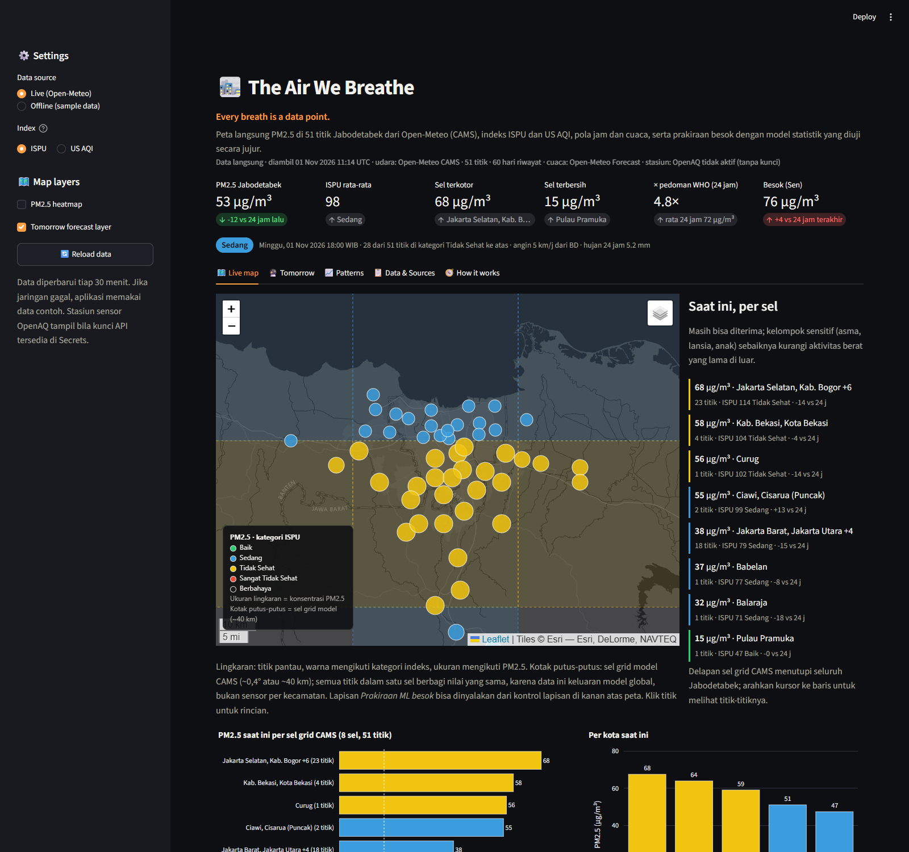
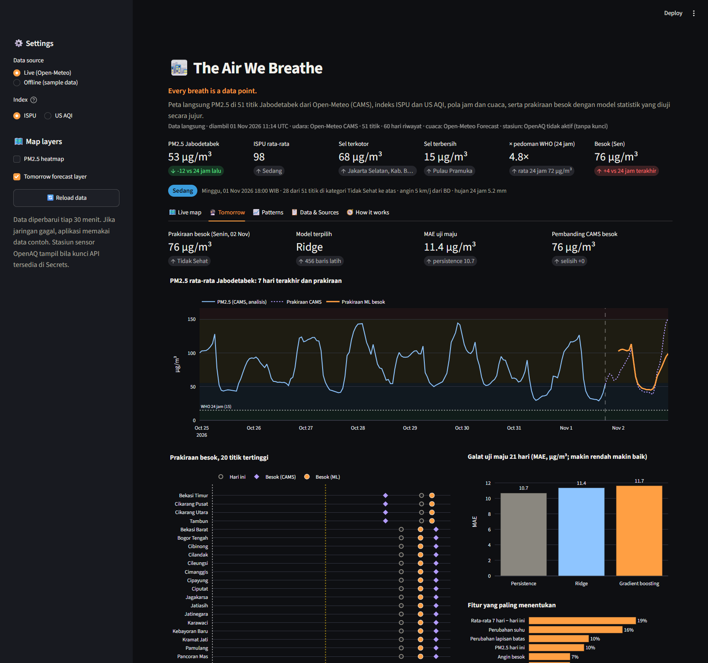
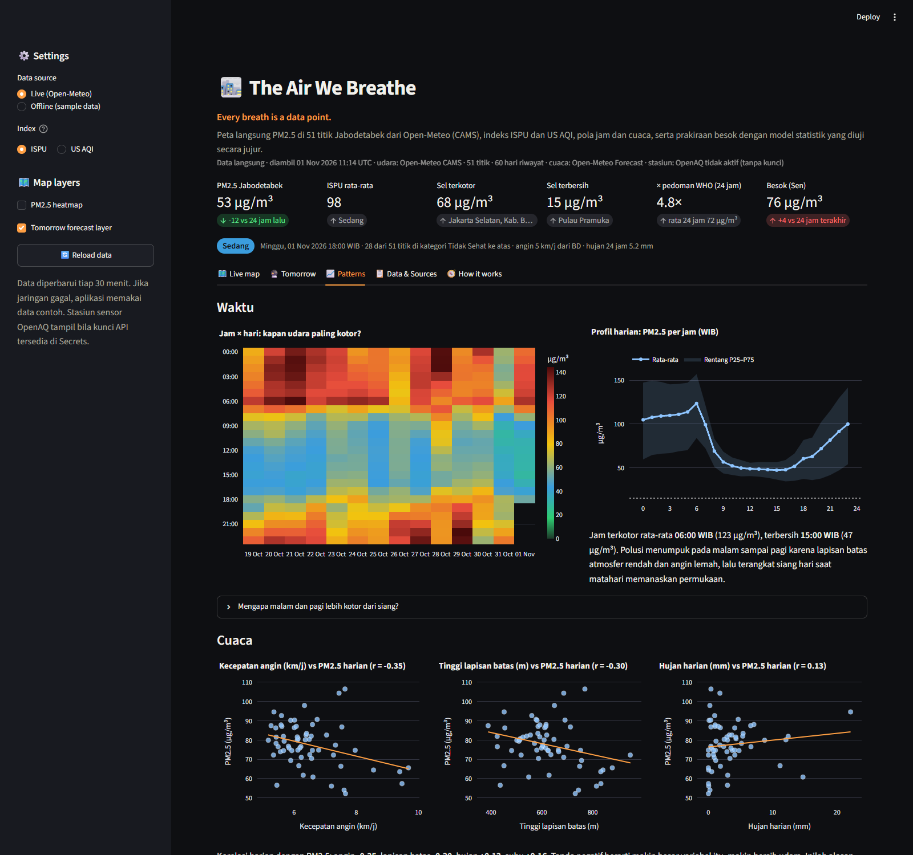
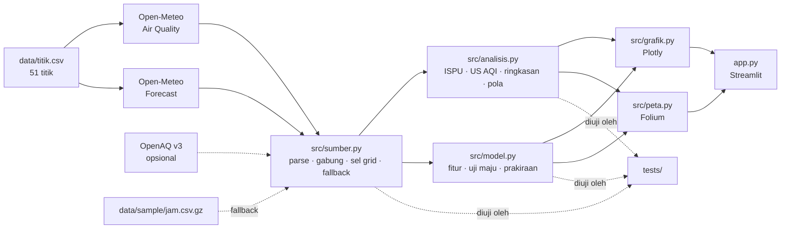

# 🌫️ The Air We Breathe

[](https://github.com/Avalon2222/the-air-we-breathe/actions/workflows/tes.yml) [](https://www.python.org/) [](LICENSE) [](https://the-air-we-breathe.streamlit.app)

> **Every breath is a data point.**
> Peta langsung PM2.5 di 51 titik Jabodetabek dari umpan publik **Open-Meteo** (model CAMS Copernicus), dengan indeks
> **ISPU** dan **US AQI**, pola jam dan cuaca, serta prakiraan besok dari model statistik yang diuji secara jujur
> melawan tebakan paling malas. Dibangun dengan Python, pandas, scikit-learn, Streamlit, Folium, dan Plotly.

## 🇬🇧 In English

**Every breath is a data point.** A live PM2.5 map of 51 points across Greater Jakarta (Jabodetabek), scored on both Indonesia's ISPU and the US AQI, with hourly and weather patterns and a tomorrow forecast from a small machine-learning model that is backtested against the laziest possible guess, and admits it when it loses.

- **Map** air quality now, with forecast layers and optional OpenAQ sensor stations.
- **Forecast** tomorrow with a persistence + correction model (Ridge or Gradient Boosting, picked automatically).
- **Backtest** 21 days of walk-forward predictions against persistence and the CAMS forecast.
- **Explore** hour-by-day heatmaps and how wind, rain, and boundary layer height drive PM2.5.

**Built with:** Python, pandas, scikit-learn, Folium, Plotly, Streamlit  
**Data:** Open-Meteo Air Quality API (Copernicus CAMS model), optional OpenAQ  
**Engineering:** pytest suite with CI on GitHub Actions, offline fallback dataset, honest model evaluation

*The rest of this README is in Indonesian.*

**🚀 Coba langsung di browser:** [the-air-we-breathe.streamlit.app](https://the-air-we-breathe.streamlit.app)



> ⚠️ **Disclaimer.** Aplikasi ini menampilkan ulang data publik untuk tujuan edukasi dan portofolio. Nilai Open-Meteo
> adalah keluaran **model**, bukan pengukuran sensor, dan bisa meleset puluhan µg/m³ dari kenyataan di lokasi tertentu.
> Prakiraan besok adalah model statistik sederhana, bukan prakiraan resmi. Untuk keputusan kesehatan, rujuk
> [ispu.menlhk.go.id](https://ispu.menlhk.go.id/) dan [udara.jakarta.go.id](https://udara.jakarta.go.id/).

## Latar belakang

Tiga puluh juta orang menghirup udara Jabodetabek, dan pada musim kemarau kawasan ini rutin masuk daftar kota
terkotor dunia. Datanya ada dan gratis, tetapi datang dalam bentuk yang menipu: titik-titik yang rapat di peta
ternyata berasal dari model global beresolusi 40 km, indeks "Sedang" di satu tabel adalah "Unhealthy" di tabel
lain, dan model prakiraan yang terlihat pintar bisa kalah dari tebakan "besok sama dengan hari ini". Proyek ini
menyatukan semuanya dalam satu aplikasi dan menuliskan jebakan-jebakannya terang-terangan.

## Fitur

| Tab | Isi |
|---|---|
| 🗺️ Live map | Peta Folium gelap: 51 titik berwarna kategori ISPU atau US AQI (ukuran = PM2.5), kotak putus-putus sel grid CAMS ~0,4°, heatmap, lapisan prakiraan besok, stasiun sensor OpenAQ (opsional), daftar titik terkotor dan terbersih, grafik per kota dan polutan lain relatif pedoman WHO |
| 🔮 Tomorrow | Prakiraan PM2.5 besok per titik dari model **persistence + koreksi** (Ridge atau Gradient Boosting, dipilih otomatis), kurva 7 hari + prakiraan per jam, pembanding prakiraan CAMS, **uji maju 21 hari** melawan persistence, fitur paling berpengaruh, dan kotak "jujur saja" bila tebakan malas masih menang |
| 📈 Patterns | Matriks jam × hari, profil harian dengan kuartil, sebaran angin / lapisan batas / hujan vs PM2.5 dengan korelasi, jumlah hari per kategori ISPU per kota, hari kerja vs akhir pekan, persen hari di atas pedoman WHO dan baku mutu nasional |
| 📋 Data & Sources | Tabel kondisi saat ini (PM2.5, PM10, NO₂, O₃, CO, SO₂, cuaca), download CSV kondisi dan riwayat per jam, tabel sumber, disclaimer |
| 🧭 How it works | Alur data dari umpan ke peta dan model |

Kartu KPI di atas: PM2.5 rata-rata Jabodetabek dan perubahan 24 jam, indeks dan kategorinya, titik terkotor dan
terbersih, **kelipatan pedoman WHO**, dan prakiraan besok.




## Cara menjalankan

```bash
git clone https://github.com/Avalon2222/the-air-we-breathe.git
cd the-air-we-breathe
python -m venv .venv && source .venv/bin/activate   # Windows: .venv\Scripts\activate
pip install -r requirements.txt
streamlit run app.py
```

Buka `http://localhost:8501`. Data diambil saat aplikasi dibuka dan disimpan 30 menit; tombol "Reload data" di
sidebar memaksa pengambilan baru. Jika jaringan tidak tersedia, aplikasi otomatis memakai data contoh di
`data/sample/` dan menampilkan spanduk peringatan. Mode offline juga bisa dipilih langsung di sidebar.

Pengujian: `python -m pytest tests/ -v` (62 tes, tanpa jaringan; otomatis jalan di GitHub Actions setiap push dan pull request). Perbarui data contoh:
`python scripts/perbarui_sample.py`.

**Stasiun sensor OpenAQ (opsional).** Daftar kunci API gratis di [explore.openaq.org](https://explore.openaq.org/),
lalu simpan sebagai `OPENAQ_API_KEY` di `.streamlit/secrets.toml` (lokal) atau di Secrets aplikasi (Streamlit
Community Cloud). Tanpa kunci, aplikasi berjalan penuh tanpa lapisan stasiun.

## Sumber data

| Sumber | Isi | Format |
|---|---|---|
| [Open-Meteo Air Quality API](https://open-meteo.com/en/docs/air-quality-api) | PM2.5, PM10, NO₂, O₃, CO, SO₂ per jam dari model CAMS global (~0,4°), 60 hari riwayat + 2 hari prakiraan, 51 titik dalam satu permintaan | JSON |
| [Open-Meteo Forecast API](https://open-meteo.com/en/docs) | Suhu, kelembapan, hujan, angin, tinggi lapisan batas per jam | JSON |
| [OpenAQ v3](https://docs.openaq.org/) (opsional) | Pembacaan sensor PM2.5 sungguhan di Jabodetabek | JSON, perlu kunci |
| Permen LHK P.14/2020 · US EPA 2024 · WHO 2021 | Titik potong ISPU, US AQI, dan pedoman WHO | tabel statis |

Rincian metodologi, termasuk mengapa 51 titik hanya memuat 8 sel dan bagaimana prakiraan diuji, ada di
[`data/SUMBER_DATA.md`](data/SUMBER_DATA.md).

## Cara kerja (ringkas)



Beberapa gagasan inti:

- **Indeks**: interpolasi linear sepotong-sepotong antar titik potong, `I = (Ia − Ib)/(Xa − Xb) × (X − Xb) + Ib`.
  PM2.5 40 µg/m³ adalah ISPU 81 "Sedang" tetapi US AQI 112 "Unhealthy for Sensitive Groups".
- **Sel grid**: Open-Meteo memakai CAMS global 0,4°, sehingga titik-titik dalam satu sel berbagi deret yang identik.
  Peta menggambarnya, dan model dilatih per sel agar satu kejadian tidak dihitung enam kali.
- **Prakiraan**: target model adalah *perubahan* dari hari ini, bukan kadar. Fiturnya kadar hari ini, selisih terhadap
  rata-rata 7 hari, prakiraan cuaca besok dan perubahannya. Uji maju 21 hari memberi MAE tiap model melawan persistence,
  dan antarmuka mengatakan terang-terangan bila persistence menang.

## Struktur proyek

```
the-air-we-breathe/
├── app.py                 # antarmuka Streamlit
├── src/
│   ├── sumber.py          # pengambilan, parser, gabung, sel grid, fallback offline
│   ├── analisis.py        # ISPU, US AQI, ringkasan, pola waktu dan cuaca
│   ├── model.py           # fitur, uji maju, prakiraan besok
│   ├── grafik.py          # grafik Plotly
│   └── peta.py            # peta Folium
├── data/
│   ├── titik.csv          # 51 titik pantau: nama, kota, wilayah, koordinat
│   ├── sample/            # tabel per jam untuk mode offline dan pengujian
│   └── SUMBER_DATA.md     # sumber dan metodologi
├── scripts/perbarui_sample.py
├── tests/                 # 62 tes pytest, tanpa jaringan
└── docs/
    ├── BELAJAR.md         # panduan belajar
    ├── LATIHAN.md         # latihan bertingkat
    └── screenshots/
```

## Belajar dari proyek ini

- [`docs/BELAJAR.md`](docs/BELAJAR.md): panduan dari nol, mulai dari mengapa PM2.5 berbahaya, membaca balasan Open-Meteo,
  jebakan resolusi grid, dua tabel indeks, lapisan batas atmosfer, sampai mengapa model prakiraan harus dibandingkan
  dengan persistence dan bagaimana menebak perubahan alih-alih kadar. Sekitar 4 jam.
- [`docs/LATIHAN.md`](docs/LATIHAN.md): sembilan latihan dari menambah satu titik pantau hingga prakiraan lusa, arsip
  SQLite, dan interval kepercayaan, masing-masing dengan petunjuk dan kunci.

## Keterbatasan

- Data CAMS global beresolusi ~40 km; perbedaan antar kecamatan di dalam satu sel **tidak** tertangkap. Lapisan OpenAQ
  ada justru untuk menunjukkan selisih model dan sensor.
- CAMS cenderung meremehkan PM2.5 di kota besar Asia Tenggara dibanding sensor permukaan.
- Model prakiraan belajar dari 60 hari keluaran CAMS; ia meniru model lain, tidak tahu musim, dan pada beberapa periode
  kalah tipis dari persistence. Angkanya arah, bukan kepastian.
- ISPU resmi memakai rata-rata 24 jam; peta "saat ini" menerapkannya pada nilai per jam, dan itu disebut apa adanya.
- Koordinat titik adalah perkiraan pusat kecamatan, bukan lokasi stasiun resmi.

## Lisensi

Kode berlisensi MIT. Data milik penyedia masing-masing (Open-Meteo CC BY 4.0, CAMS Copernicus, OpenAQ sesuai penyedia)
dan tunduk pada ketentuan penggunaannya.
