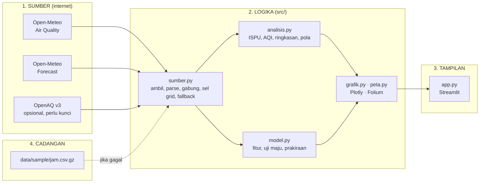

# 🎓 Panduan Belajar: Membaca Udara Jabodetabek dengan Python

Panduan ini untuk pembaca yang sudah bisa menjalankan skrip Python sederhana tetapi belum pernah memanggil API
cuaca, menghitung indeks kualitas udara, atau melatih model prakiraan. Tujuannya bukan menghafal kode, melainkan
memahami **mengapa** kodenya ditulis begitu, termasuk keputusan yang tidak nyaman seperti "model kita kalah dari
tebakan malas". Bacalah sambil membuka berkas yang disebut, dan ubah sesuatu di setiap bagian. Jika rusak,
`git checkout -- .` mengembalikan semuanya.

Perkiraan waktu: 4 jam, boleh dibagi beberapa sesi.

---

## Bab 0 — Mengapa Jabodetabek?

Sekitar 30 juta orang tinggal di Jakarta, Bogor, Depok, Tangerang, dan Bekasi, dan pada musim kemarau kawasan ini
rutin masuk daftar kota dengan udara terkotor di dunia. Partikel yang paling berbahaya adalah **PM2.5**: debu dan
tetesan berdiameter di bawah 2,5 mikrometer (sekitar 1/30 tebal rambut) yang cukup kecil untuk masuk ke alveolus paru
dan aliran darah. WHO menetapkan pedoman 15 µg/m³ untuk rata-rata 24 jam; Jakarta sering berada di 3–5 kalinya.

Pertanyaan yang ingin dijawab aplikasi ini:

1. Seberapa kotor udara **sekarang**, di mana, dan dalam indeks apa?
2. **Kapan** dalam sehari dan dalam sepekan udara paling kotor, dan apa peran cuaca?
3. Berapa kadar PM2.5 **besok**, dan seberapa percaya kita pada tebakan itu?



**Mengapa dipisah?** Supaya setiap bagian bisa diuji dan diganti sendiri-sendiri. `analisis.py` dan `model.py` tidak
tahu Streamlit ada; mereka hanya menerima tabel dan mengembalikan tabel atau angka. Itulah yang membuat keduanya
mudah diuji oleh `pytest` tanpa jaringan.

---

## Bab 1 — Mengambil data dari internet (`src/sumber.py`)

### 1.1 Satu permintaan untuk 51 lokasi

Open-Meteo menerima daftar koordinat dalam satu permintaan: `latitude=-6.195,-6.176,...&longitude=106.832,...`.
Buka `URL_UDARA` di browser dengan dua koordinat dan lihat bentuknya: sebuah **list** berisi satu objek per lokasi,
masing-masing dengan `hourly.time` dan larik per variabel. Dengan satu lokasi, balasannya **dict**, bukan list.
Perbedaan kecil seperti ini adalah sumber bug klasik, dan `parse_open_meteo` menanganinya di baris pertamanya.

```python
blok = payload if isinstance(payload, list) else [payload]
```

### 1.2 Urutan, bukan koordinat

Koordinat di balasan Open-Meteo sudah dibulatkan ke grid modelnya (`-6.195` menjadi `-6.2`). Kalau kita mencocokkan
titik dengan koordinat balasan, titik yang berdekatan akan tertukar. Karena itu `parse_open_meteo` memakai **urutan**:
lokasi ke-i di balasan adalah baris ke-i di `titik.csv`. Fungsi itu juga memeriksa jumlahnya sama dan melempar
`ValueError` bila tidak. Lebih baik gagal keras daripada diam-diam salah.

### 1.3 Format panjang (long) vs lebar (wide)

Setiap lokasi menjadi beberapa ribu baris `titik, waktu, pm2_5, ...` yang lalu disusun dengan `pd.concat`. Ini format
**panjang**: satu baris = satu titik pada satu jam. Format ini membosankan tetapi serbaguna; `groupby` apa pun bisa
dibuat darinya. Format **lebar** (kolom per titik) hanya dibuat saat benar-benar perlu, misalnya `pivot` di Bab 3.

### 1.4 Zona waktu

Kita meminta `timezone=Asia/Jakarta`, jadi string waktu di balasan sudah WIB tetapi **tanpa** informasi zona.
`dt.tz_localize("Asia/Jakarta")` menempelkannya. Semua perbandingan waktu di proyek ini memakai Timestamp sadar zona;
mencampur yang sadar dan tidak sadar zona akan melempar `TypeError`, dan itu memang kita inginkan.

### 1.5 Menandai mana yang prakiraan

Open-Meteo mengembalikan 60 hari ke belakang **dan** 2 hari ke depan dalam satu larik, tanpa penanda. `gabung`
menandai `prakiraan = waktu > waktu_ambil` (dibulatkan ke jam). Satu kolom boolean ini dipakai di mana-mana:
`waktu_sekarang` adalah jam pengamatan terakhir, pola dihitung dari jam pengamatan saja, dan model memakai jam
prakiraan hanya untuk fitur cuaca besok.

### 1.6 Sel grid: pelajaran paling penting di bab ini

Jalankan ini:

```python
from src import sumber
jam, _ = sumber.muat_sample()
jam[jam["waktu"] == jam["waktu"].max()]["pm2_5"].nunique()
```

Hasilnya **8**, bukan 51. Open-Meteo memakai model CAMS global beresolusi 0,4° (~40 km); seluruh Jabodetabek hanya
delapan sel, dan 18 kecamatan Jakarta Utara–Pusat–Barat berbagi satu angka yang sama. Fungsi `sel_grid` menghitung pusat
sel dari koordinat (pusat di kelipatan 0,4°, batas di ±0,2°), dan `tests/test_sumber.py` memastikan semua titik sesel
memang punya deret identik di data contoh. Mengapa repot? Karena (1) peta harus jujur menampilkannya (kotak putus-putus),
dan (2) model tidak boleh menghitung satu kejadian sebagai enam kejadian (Bab 4).

Pelajaran umumnya: **selalu tanya resolusi data sebelum menggambar peta.** Titik yang rapat tidak berarti informasi yang rapat.

### 1.7 OpenAQ dan kunci API

OpenAQ mengumpulkan sensor sungguhan, tetapi API v3-nya perlu kunci (gratis). `kunci_openaq` mencari kunci di
variabel lingkungan lalu di `st.secrets`; tanpa kunci, lapisan stasiun dilewati tanpa error. Pola ini, **fitur opsional
yang menyala bila konfigurasinya ada**, lebih ramah daripada aplikasi yang menolak berjalan.

### 1.8 Fallback

`muat_semua` membungkus pengambilan dalam `try/except (requests.RequestException, ValueError, KeyError)`. Bila gagal,
ia membaca `data/sample/jam.csv.gz`. Berkas itu tabel panjang yang sama, disimpan gzip agar 76 ribu baris hanya 2 MB.
Perhatikan: data contoh menyimpan `prakiraan` sebagaimana adanya saat diunduh, sehingga dalam mode offline "sekarang"
adalah jam pengamatan terakhir di berkas, bukan jam di dinding. Semua logika hilir tetap bekerja tanpa cabang khusus.

**Coba:** matikan Wi-Fi, jalankan `streamlit run app.py`. Spanduk oranye harus muncul dan semuanya tetap jalan.

---

## Bab 2 — Dari konsentrasi ke indeks (`src/analisis.py`)

### 2.1 Mengapa ada indeks?

"PM2.5 = 72 µg/m³" tidak berarti apa-apa bagi kebanyakan orang. Indeks memetakan konsentrasi ke skala 0–500 dengan
kategori berwarna. Masalahnya, tiap negara memetakan dengan cara berbeda. Aplikasi ini menghitung dua:

- **ISPU** (Permen LHK 14/2020), indeks resmi Indonesia. PM2.5 sampai 15,5 µg/m³ adalah "Baik", sampai 55,4 "Sedang".
- **US AQI** (EPA), yang dipakai aplikasi cuaca dan kedutaan. Sejak 2024 batas "Good" hanya 9,0 µg/m³.

Konsentrasi 40 µg/m³ adalah ISPU 81 "Sedang" (biru) tetapi US AQI 112 "Unhealthy for Sensitive Groups" (oranye).
Perdebatan "udara Jakarta sedang atau tidak sehat?" sering kali hanya perbedaan tabel.

### 2.2 Interpolasi linear sepotong-sepotong

Kedua indeks memakai rumus yang sama:

```
I = (I_atas − I_bawah) / (C_atas − C_bawah) × (C − C_bawah) + I_bawah
```

Di `_interpolasi`, tabel titik potong disimpan sebagai daftar tuple dan rumusnya diterapkan ke seluruh larik numpy
sekaligus lewat **topeng boolean**: `topeng = (c >= c_lo) & (c <= c_hi)`. Tidak ada `for` per baris; 76 ribu nilai
selesai dalam milidetik. Perhatikan `& np.isnan(hasil)` yang mencegah nilai tepat di batas dihitung dua kali.

**Coba:** `analisis.ispu_pm25(55.4)` dan `analisis.ispu_pm25(55.5)`. Mengapa yang kedua melompat dari 100 ke 101?

### 2.3 Skalar, Series, larik: satu fungsi untuk semua

`_bungkus` mengembalikan `float` bila masukannya skalar, `pd.Series` dengan indeks yang sama bila masukannya Series,
dan `ndarray` selebihnya. Ini membuat `ispu_pm25(40)` dan `df["pm2_5"].pipe(ispu_pm25)` sama-sama enak dipakai.
Harga yang dibayar: `_kategori` harus memakai `np.atleast_1d` agar kasus 0-dimensi tidak meledak. Lihat
`test_indeks_menerima_series_dan_nan`.

### 2.4 Rata-rata arah angin

Rata-rata biasa dari 350° dan 10° adalah 180°, arah yang berlawanan dengan keduanya. `_rata_arah` mengubah derajat ke
vektor satuan, merata-ratakan komponen sinus dan kosinus, lalu `arctan2` kembali ke derajat. Setiap kali Anda
merata-ratakan sesuatu yang "melingkar" (jam, bulan, sudut), ingat trik ini.

### 2.5 Ringkasan dan "sekarang"

`kondisi_terkini` mengambil baris pada jam `sekarang`, menempelkan nilai 24 jam lalu (`delta_24j`) dan rata-rata
24 jam terakhir (`pm2_5_24j`). Kartu "× pedoman WHO" memakai rata-rata 24 jam, bukan nilai sesaat, karena pedoman WHO
memang untuk 24 jam. Membandingkan nilai per jam dengan ambang harian adalah kesalahan umum di media.

---

## Bab 3 — Pola waktu dan cuaca

### 3.1 Profil harian

`profil_jam` mengelompokkan menurut `waktu.dt.hour` dan menghitung rata-rata serta kuartil. Hasilnya hampir selalu
berbentuk sama: puncak subuh sampai pagi, lembah siang–sore. Penjelasannya fisika: siang hari matahari memanaskan tanah,
udara naik, **lapisan batas** menebal 1–2 km, dan emisi yang sama tersebar dalam volume besar. Malam hari lapisan
menipis sampai ratusan meter dan konsentrasi naik meski emisinya tidak bertambah. Kolom `blh` (boundary layer height)
dari Open-Meteo memperlihatkan ini langsung; korelasinya dengan PM2.5 negatif.

### 3.2 Matriks jam × hari

`matriks_jam_hari` memakai `pivot_table(index=jam, columns=tanggal)`. Dua pola terlihat sekaligus: garis horizontal
(jam yang selalu kotor) dan kolom vertikal (hari yang kotor sepanjang hari, biasanya hari tanpa angin dan hujan).

### 3.3 Korelasi, bukan sebab

`korelasi_cuaca` menghitung Pearson antara rata-rata harian PM2.5 dan angin, hujan, lapisan batas, suhu. Angin dan
lapisan batas biasanya negatif (mengencerkan), hujan negatif atau mendekati nol (mencuci partikel, tetapi hari hujan di
musim pancaroba juga hari lembap dan tenang). Enam puluh titik data harian terlalu sedikit untuk kesimpulan kuat; grafik
sebaran dengan garis tren di tab Patterns ada untuk membuat pembaca **melihat** seberapa berisik hubungannya.

---

## Bab 4 — Prakiraan besok (`src/model.py`)

Bab ini yang paling penting, karena di sinilah proyek ini sengaja memperlihatkan bagaimana pekerjaan data yang jujur
terlihat.

### 4.1 Rumuskan dulu pertanyaannya

"Prediksi polusi besok" terlalu kabur. Pertanyaan yang bisa dilatih: **berapa rata-rata PM2.5 di sel S pada hari H+1,
diketahui semua yang kita tahu pada sore hari H?** Dari sini turun tiga keputusan:

- **Unit**: sel × hari (Bab 1.6). `tabel_harian` merata-ratakan per sel dan per tanggal.
- **Target**: rata-rata harian, bukan per jam. Per jam terlalu berisik untuk 60 hari data.
- **Fitur**: hanya yang tersedia saat prakiraan dibuat. Prakiraan cuaca besok **boleh** dipakai, karena model cuaca
  memang sudah menerbitkannya; PM2.5 besok dari CAMS **tidak boleh** jadi fitur, karena itu jawaban yang mau kita tebak.

### 4.2 Lag dan kebocoran

`tambah_fitur` membuat `lag1` dengan `groupby("sel")["pm2_5"].shift(1)`. `groupby` penting: tanpa itu, baris pertama
sel B akan mendapat nilai terakhir sel A. `rata7` memakai `.shift(1).rolling(7)`: geser dulu, baru gulung, agar hari H
sendiri tidak ikut dalam rata-rata yang seharusnya "7 hari sebelum H". Lupa `shift(1)` di sini adalah **kebocoran**
(leakage): model terlihat hebat saat diuji dan gagal saat dipakai.

### 4.3 Persistence: lawan yang harus dikalahkan

Tebakan paling malas untuk besok adalah hari ini. Pada horizon satu hari, tebakan ini sangat kuat karena polusi
"lengket" (autokorelasi tinggi). Setiap model prakiraan harus dibandingkan dengannya; model yang kalah dari persistence
tidak berguna, seberapa pun canggihnya.

### 4.4 Menebak koreksi, bukan kadar

Versi pertama proyek ini menebak kadar langsung dan **kalah** dari persistence dengan MAE 11 vs 9,5 µg/m³. Sebabnya
terlihat di kolom `bias`: +7. Data latih (September–Oktober, kemarau) lebih kotor daripada pekan-pekan uji (awal musim
hujan), dan model yang belajar "rata-rata sel ini 80" terus menebak 80 saat kenyataannya sudah 60. Persistence tidak
punya masalah itu: ia beradaptasi seketika.

Perbaikannya sederhana: ubah target menjadi **perubahan**, `pm2_5 − lag1`, lalu prediksi = `lag1 + koreksi`. Model
sekarang mulai dari tebakan malas dan hanya menambah bila fitur memberi alasan. Fiturnya pun dibuat relatif:
`rata7_minus_lag1` (seberapa jauh hari ini dari kebiasaannya; cenderung kembali ke rata-rata) dan `d_angin`, `d_hujan`,
`d_blh` (apakah besok lebih berangin, lebih basah, lebih "tinggi" dari hari ini). Lihat `latih` dan `prediksi`.

### 4.5 Uji maju

`uji_maju` mengulang untuk 21 hari terakhir: latih dengan semua hari **sebelum** hari uji, tebak hari uji, catat
galatnya. Ini meniru cara model dipakai sungguhan. Pembagian acak train/test (seperti `train_test_split`) **salah**
untuk deret waktu karena membiarkan model mengintip masa depan. Tiga metrik dilaporkan: MAE (rata-rata galat mutlak),
RMSE (lebih menghukum galat besar), dan bias (apakah model sistematis terlalu tinggi atau rendah).

Jalankan sendiri:

```python
from src import sumber, model
jam, _ = sumber.muat_sample()
p = model.latih_dan_prakirakan(jam)
print(p.backtest)
```

Bila persistence masih menang tipis, itu **bukan bug**. Aplikasi menampilkannya apa adanya dengan kotak biru "Jujur
saja". Dengan 8 sel dan 60 hari, memang sedikit yang bisa dipelajari di luar "besok mirip hari ini, sedikit lebih
bersih kalau berangin". Yang membedakan pekerjaan data yang baik bukan selalu menang, melainkan **tahu dan mengatakan
kapan model tidak lebih baik dari tebakan sederhana**.

### 4.6 Ridge vs Gradient Boosting

- **Ridge** = regresi linear dengan penalti pada koefisien besar (`alpha=10`). `StandardScaler` di depannya membuat
  penalti adil antar fitur yang skalanya beda (angin km/jam vs lapisan batas meter). Koefisiennya bisa dibaca:
  tanda negatif pada `d_angin` berarti "makin berangin besok, makin turun".
- **Gradient Boosting** = ratusan pohon keputusan kecil yang masing-masing memperbaiki sisa galat pohon sebelumnya.
  Bisa menangkap hubungan tidak linear (hujan hanya berpengaruh bila di atas sekian mm) tetapi mudah *overfit* pada
  data sekecil ini, sehingga kedalaman dibatasi 2 dan tiap daun minimal 5 sampel.

`pentingnya_fitur` menampilkan koefisien absolut (Ridge) atau *feature importance* (GBR), dinormalkan agar jumlahnya 1.

### 4.7 Dari harian ke per jam

Model menghasilkan satu angka per sel untuk besok. Untuk menggambar kurva per jam, `profil_diurnal` menghitung rasio
tiap jam terhadap rata-rata harinya selama 14 hari terakhir per sel, lalu angka harian dikalikan profil itu. Bentuk
kurvanya jadi "pinjaman" dari masa lalu; hanya tingginya yang diprediksi. Ini asumsi yang jujur dan murah.

### 4.8 Kejujuran yang tertulis di antarmuka

Tiga keterbatasan sengaja ditulis di tab Tomorrow: (1) fitur "hari ini" saat prakiraan baru mencakup jam yang sudah
lewat; (2) data latih adalah keluaran model CAMS, jadi kita belajar meniru model lain; (3) 60 hari tidak memuat musim.
Membaca batasan di aplikasi lebih baik daripada menemukannya setelah salah mengambil keputusan.

---

## Bab 5 — Peta dan grafik

### 5.1 Folium

`peta.buat_peta` menggambar tiga jenis lapisan: `Rectangle` untuk sel grid (putus-putus, transparan), `CircleMarker`
untuk titik (warna kategori, jari-jari dari `radius(pm)` yang tumbuh pelan dan dibatasi 22 px), dan
`RegularPolygonMarker` belah ketupat untuk stasiun OpenAQ. `prefer_canvas=True` membuat puluhan penanda digambar
di satu kanvas, bukan puluhan elemen SVG. Legenda adalah HTML kecil yang disuntik lewat `MacroElement`
karena Folium tidak punya legenda bawaan.

### 5.2 Plotly dan pita kategori

`grafik._pita_ispu` menambahkan `add_hrect` berwarna kategori di latar grafik garis. Pembaca langsung melihat kapan
garis melewati batas "Tidak Sehat" tanpa membaca angka. Garis putus-putus putih di 15 µg/m³ adalah pedoman WHO; ia
hampir selalu berada jauh di bawah semua data, dan itu sendiri sebuah pesan.

---

## Bab 6 — Streamlit: model mental

- **Skrip dijalankan ulang dari atas setiap interaksi.** Karena itu pengambilan data dan pelatihan model dibungkus
  `@st.cache_data(ttl=1800)`. Argumen fungsi menjadi kunci cache; untuk `prakirakan`, DataFrame 76 ribu baris diberi
  awalan garis bawah (`_jam`) agar tidak di-hash, dan kunci yang dipakai adalah `waktu_ambil`.
- **Tombol Reload** memanggil `.clear()` pada kedua cache lalu `st.rerun()`.
- **Tab bukan halaman**: semua tab dihitung setiap kali. Bila aplikasi terasa lambat, pindahkan perhitungan berat ke
  fungsi yang di-cache, bukan ke tab lain.
- **Rahasia** (`OPENAQ_API_KEY`) dibaca dari `st.secrets`, yang di Streamlit Community Cloud diisi lewat pengaturan
  aplikasi, dan secara lokal dari `.streamlit/secrets.toml` yang ada di `.gitignore`.

---

## Bab 7 — Pengujian

Tiga berkas di `tests/`:

- `test_sumber.py`: parser diuji dengan **tiruan balasan** yang dibuat fungsi `payload_open_meteo`, bukan jaringan.
  Satu tes memastikan asumsi grid 0,4° masih berlaku pada data contoh; bila Open-Meteo mengganti model, tes ini yang
  pertama berteriak.
- `test_analisis.py`: titik potong ISPU dan AQI diuji satu per satu dengan `pytest.mark.parametrize`, plus sifat
  **monoton naik** (indeks tak boleh turun saat konsentrasi naik), yang menangkap kesalahan ketik di tabel.
- `test_model.py`: data sintetis yang polanya kita tentukan sendiri (`pm = 60 − 3·angin − 0,8·hujan + sisa AR(1)`).
  Dengan data buatan kita tahu jawaban yang benar: Ridge **harus** mengalahkan persistence karena target bergantung
  pada cuaca besok yang tidak diketahui persistence, dan prakiraan **harus** turun bila angin besok dinaikkan.

Jalankan `python -m pytest tests/ -v`. Tes yang gagal karena asumsi lama (misalnya Anda menambah titik ke-52) adalah
tes yang bekerja dengan benar; perbarui angkanya.

---

## Penutup

Yang dibawa pulang dari proyek ini, urut dari yang paling penting:

1. Tanya resolusi data sebelum menggambar peta.
2. Bandingkan setiap model prakiraan dengan persistence, dan laporkan bila kalah.
3. Tebak perubahan, bukan kadar, saat deretnya lengket dan rezimnya bisa bergeser.
4. Jangan pernah membiarkan masa depan bocor ke fitur (`shift(1)` sebelum `rolling`).
5. Pisahkan pengambilan, logika, dan tampilan agar logikanya bisa diuji tanpa jaringan.

Lanjutkan ke `LATIHAN.md`.
